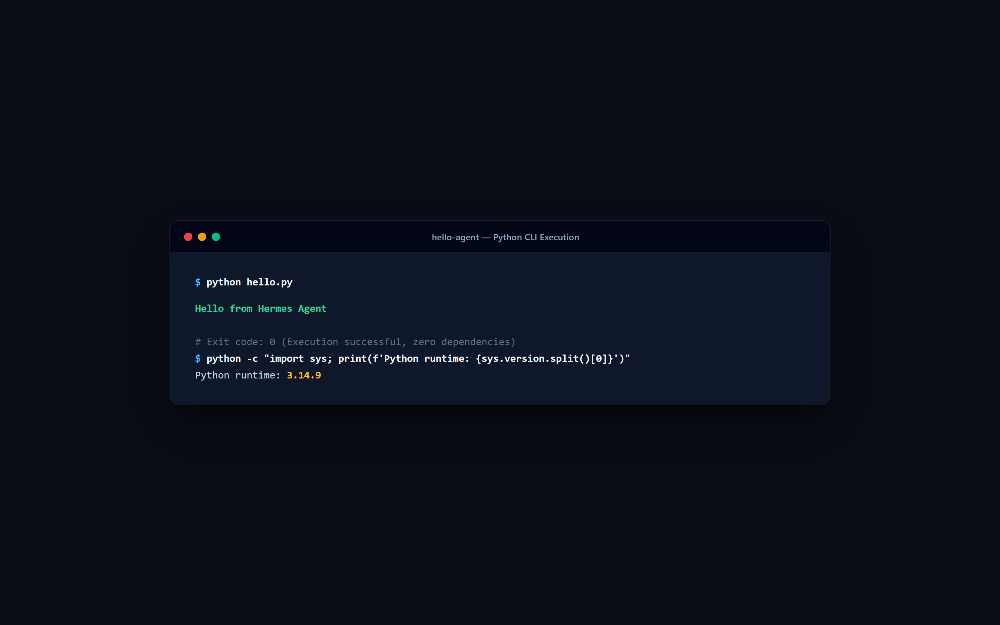

# hello-agent

A small Python project that prints "Hello from Hermes Agent".

Repository: https://github.com/0xyz-exe/hello-agent

## Screenshots

### 1. CLI Execution Output
Output eksekusi terminal Python zero-dependency yang memverifikasi kesiapan lingkungan runtime dan eksekusi pesan salam resmi:


## How to run

1. Ensure you have Python installed (no external packages required).
2. Navigate to this directory:
   ```
   cd C:\Users\wondr\HermesWorkspace\hello-agent
   ```
3. Run the script:
   ```
   python hello.py
   ```

## Output

```
Hello from Hermes Agent
```